<p align="center">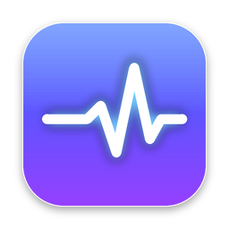</p>

<h1 align="center">PulseDock for macOS</h1>

<p align="center">
  A modern system monitor for the Mac: live CPU, memory, disk, GPU, network and battery in the menu bar and a floating Liquid Glass widget —
  plus one-click <b>Free up memory</b> and <b>Disk Cleanup</b>.<br>
  <b>English</b> · <a href="README.pt-BR.md">Português</a>
</p>

<p align="center">
  <a href="https://github.com/filipembcruz/pulsedock-mac/releases/latest/download/PulseDock.dmg"><b>⬇ Download PulseDock.dmg</b></a>
  &nbsp;·&nbsp; macOS 14 Sonoma or later · Apple silicon &amp; Intel (universal) · free &amp; open source (MIT)
</p>

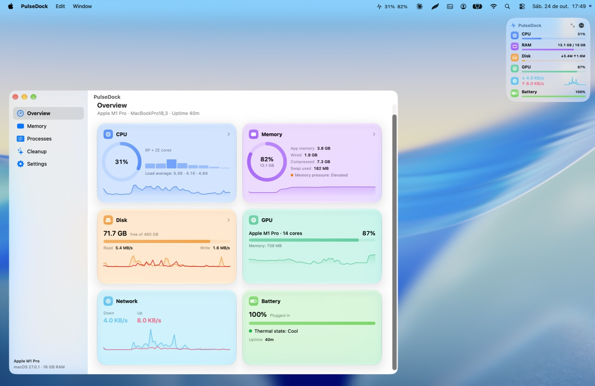

The macOS sibling of [PulseDock for Windows](https://github.com/filipembcruz/pulsedock). Written in Swift + SwiftUI,
with the Liquid Glass look of macOS 26 / 27 (falls back to translucent materials on macOS 14–15).

## Install

1. Download [`PulseDock.dmg`](https://github.com/filipembcruz/pulsedock-mac/releases/latest/download/PulseDock.dmg) from the latest Release.
2. Open it and drag **PulseDock** to **Applications**.
3. **First launch:** the app is ad-hoc signed (not notarized — that needs a paid Apple Developer account), so macOS blocks it the first time and offers only *Move to Trash* / *Done*.
   Click **Done**, open *System Settings → Privacy & Security*, scroll to the bottom and click **Open Anyway** next to "PulseDock", then confirm with Touch ID or your password. (On macOS 14 you can also right-click PulseDock → **Open** → **Open**.) Every newly downloaded version asks once.
   Prefer Terminal? Run `xattr -dr com.apple.quarantine /Applications/PulseDock.app`. If it says *Operation not permitted*, Terminal needs *System Settings → Privacy & Security → App Management*; the **Open Anyway** button above is simpler.
4. Look for the **pulse icon** in the menu bar. The widget appears in the top-right corner.

**Build it yourself** (needs Xcode 26 or its Command Line Tools): `./scripts/install.sh` builds, installs to /Applications and opens it.

## Screenshots

| Widget · compact (default) | Widget · full | Menu bar |
|:---:|:---:|:---:|
| 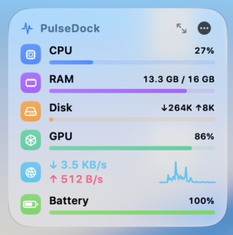 | 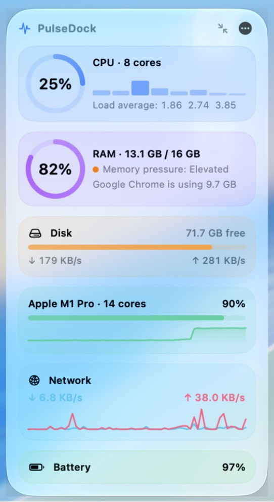 | 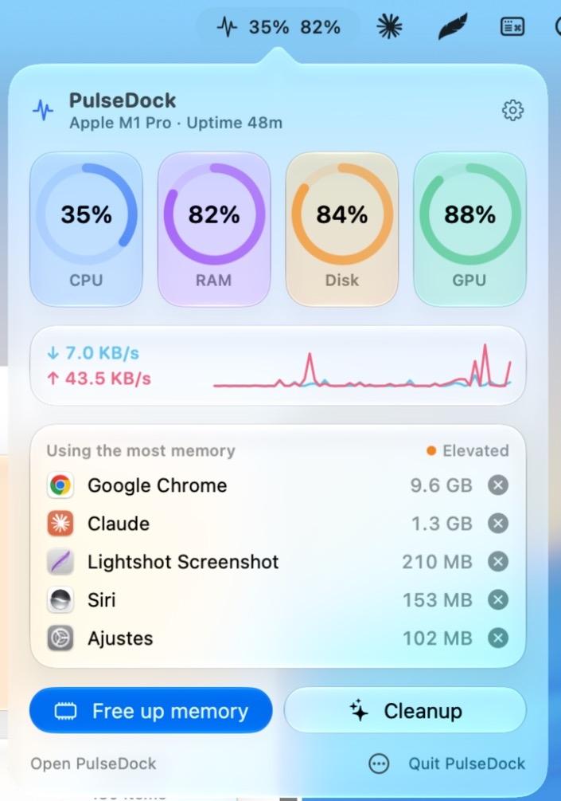 |

**Widget · strip**

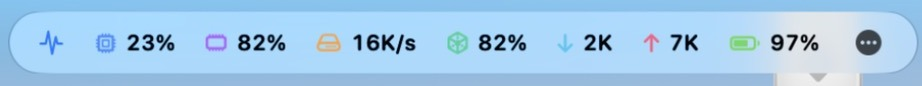

| Overview | Free up memory |
|:---:|:---:|
| 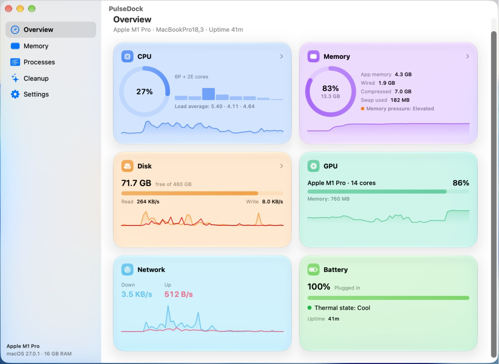 | 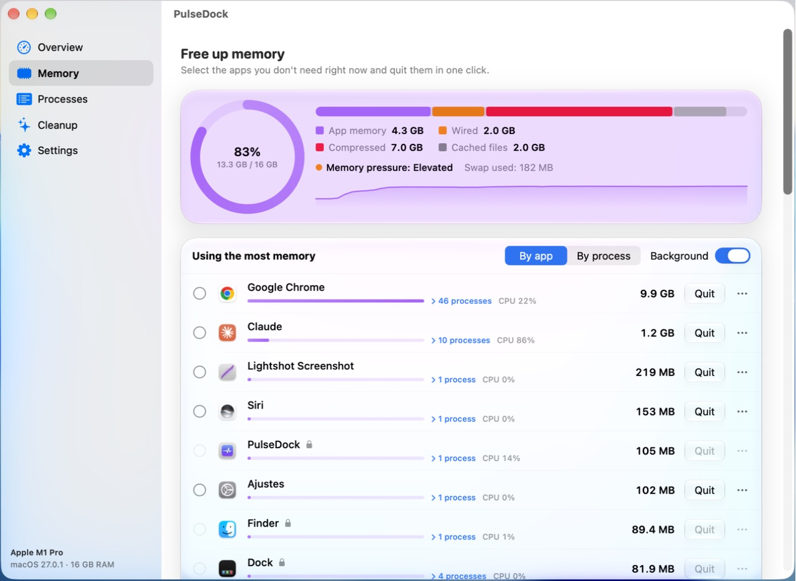 |
| **Expand an app to see its processes** | **…or list every process by memory** |
| 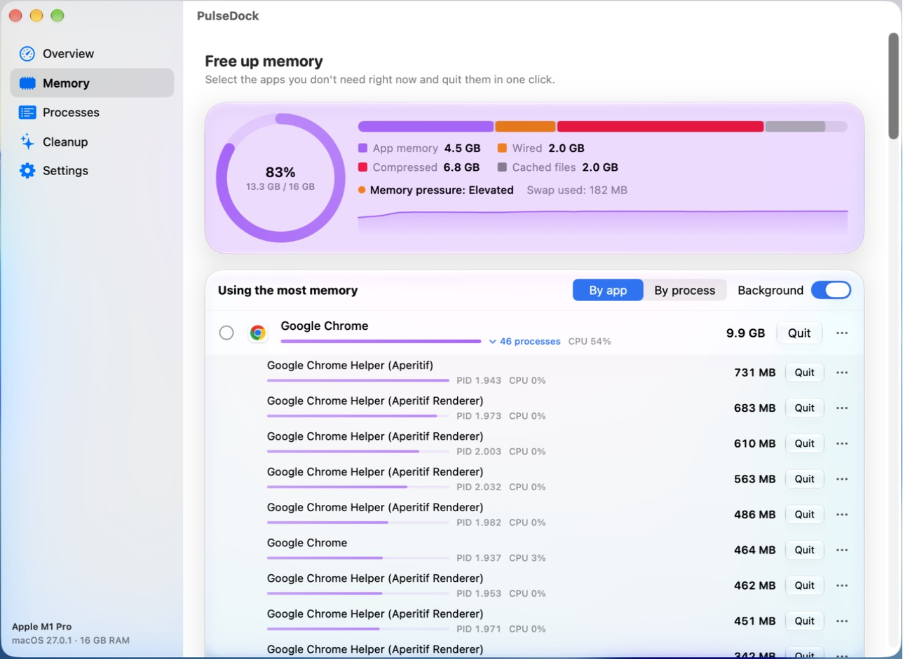 | 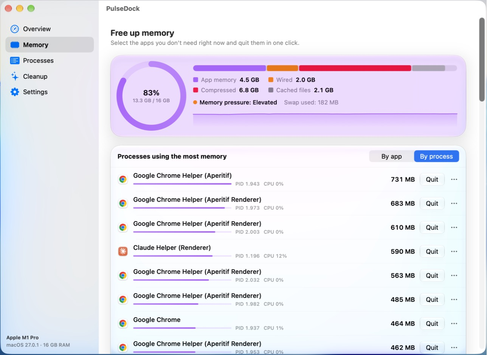 |
| **Processes** | **Disk Cleanup** |
| 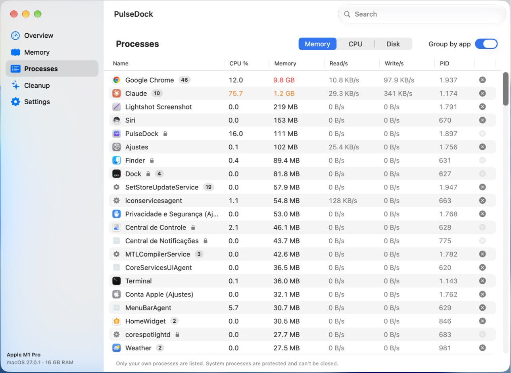 | 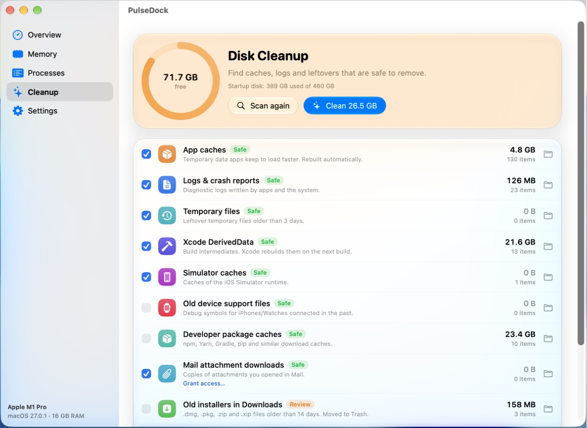 |

<p align="center">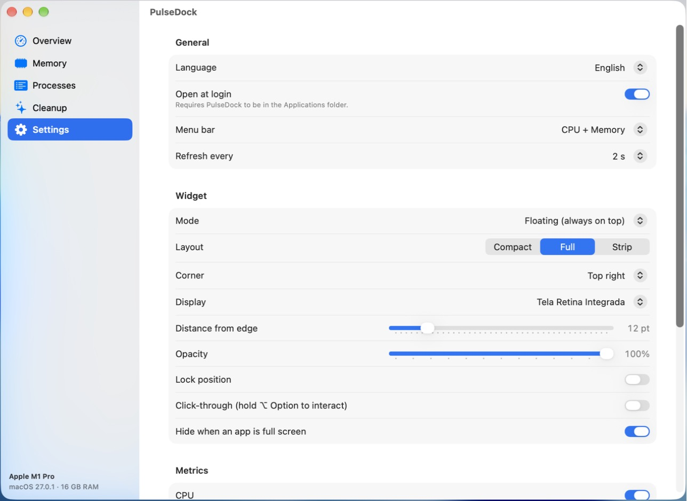</p>

## Features

**Everything PulseDock for Windows has**
- **At a glance:** CPU (total, per core, load average), memory (used/total, pressure, swap), disk (read/write speed, activity, free space), GPU (usage and memory for every GPU), network (download/upload with a live chart), battery and thermal state.
- **Find what's slowing you down:** click CPU, Memory or Disk to see the heaviest apps and **end them**, with confirmation. System processes are protected.
- **Three layouts:** compact (default), full and horizontal strip — switch with ⤢ or the ⋯ menu.
- **Three modes:** floating (always on top), on the desktop (behind your windows), or menu bar only.
- **Put it anywhere:** pin to any of the 4 corners, drag it anywhere (it snaps to corners when dropped nearby), lock position, choose the display and the distance from the edge.
- **Starts with your Mac:** *Open at login* is on by default (toggle it in the **⋯** menu or *Settings → General*).
- **Extras:** click-through (hold **⌥ Option** to interact), hide while an app is full screen, opacity and refresh rate, show/hide each metric.
- **Languages:** English (default) and Português. Switch any time from the widget's **⋯** menu → *Language*, or in *Settings → General*. *Automatic* follows the macOS language.

**New on the Mac**
- **Free up memory:** a page dedicated to RAM — breakdown (app, wired, compressed, cached), pressure, and the apps using the most memory *grouped by app* (Chrome + all its helpers = one row). Tick several and **Quit N selected** in one click, or Force Quit a hung app.
  - Click **“N processes”** under an app to expand it and see which of its processes (a heavy browser tab, a renderer…) uses the most memory — and quit just that one.
  - Switch to **By process** to list the 50 individual processes using the most RAM.
- **Processes:** an Activity-Monitor-style table — sort by memory, CPU or disk, search, group by app, right-click to quit / force quit / show in Finder.
- **Disk Cleanup:** one **Scan** and one **Clean** button for:
  - App caches · Logs & crash reports · old temporary files · Mail attachment downloads
  - Xcode DerivedData · Simulator caches · old device support files · npm / Yarn / Gradle / pip caches
  - Old installers (.dmg, .pkg, .zip, .xip) in Downloads · the Trash
  - **Large files** (> 500 MB) in your home folder, to review and move to the Trash one by one

  Each category shows its size and whether it's *Safe* (regenerable data, deleted) or needs a *Review* (your own files, moved to the Trash so you can undo).
- **Menu bar item** with CPU / memory / network readout and a glass popover: gauges, top memory apps with a quick ✕, and shortcuts to Free up memory and Cleanup.

## How to use

| To… | Do this |
|---|---|
| Open the full app | Click the menu bar icon → **Open PulseDock**, or click any widget row |
| Free memory | Popover → **Free up memory**, tick apps → **Quit selected** |
| Clean the disk | Popover → **Cleanup** → **Scan** → **Clean** |
| Change layout, mode or corner, lock, quit | **⋯** on the widget, or right-click it |
| Move the widget | Drag it. Drop near a corner to snap |
| Lost the widget? | Right-click the menu bar icon → **Move widget back to its corner** |

Settings live in the app's preferences (`defaults read io.github.filipembcruz.PulseDock`).

## Permissions & privacy

- No network access, no analytics. Everything is read locally through public macOS APIs (Mach host statistics, `libproc`, IOKit).
- Only **your own processes** can be listed and closed — macOS doesn't allow an app to end system processes, and PulseDock also refuses to touch a protected list (WindowServer, Finder, Dock, loginwindow…).
- Some cleanup folders (Mail downloads, Trash, Downloads) are protected by macOS. The first scan may ask for access; for full results grant **Full Disk Access** (*System Settings → Privacy & Security*). The **Grant access…** link opens that pane.
- CPU / GPU temperatures need private Apple interfaces, so PulseDock shows the official **thermal state** instead.

## Build from source

```bash
git clone https://github.com/filipembcruz/pulsedock-mac
cd pulsedock-mac
./scripts/build-app.sh        # → dist/PulseDock.app, PulseDock.dmg, PulseDock.zip
./scripts/install.sh          # build for this Mac and install to /Applications
swift run                     # quick debug run (without app bundle)
```

Every push to `main` builds the universal app on GitHub Actions (`macos-26` runner) and publishes a Release with the `.dmg` and `.zip`.

### Project structure

```
Sources/PulseDock/
  App/        entry point, menu bar item, popover, main window
  Models/     settings
  Services/   SystemSampler (CPU, memory, disk, GPU, network, battery), ProcessMonitor (+ quit),
              DiskCleaner, L10n (EN/PT strings), login item, full-screen detection
  UI/         widget (3 layouts) + panel controller, popover, Overview, Memory, Processes, Cleanup, Settings,
              Liquid Glass helpers and components
Resources/    Info.plist, AppIcon.png
scripts/      build-app.sh, install.sh
```

**Translations:** all UI text is in `Sources/PulseDock/Services/L10n.swift` as English/Portuguese pairs.

## License

MIT
